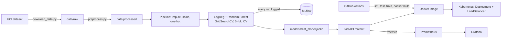

# Heart Disease Risk Prediction: End-to-End MLOps

A reproducible ML pipeline that predicts heart disease risk from patient health data
(UCI Heart Disease, Cleveland), with experiment tracking, automated tests, CI/CD,
Docker packaging, Kubernetes deployment and Prometheus/Grafana monitoring.

**Repository:** `<<YOUR GITHUB URL>>`

## Architecture



## Quick start (clean setup)

```bash
python -m venv .venv
source .venv/bin/activate          # Windows: .venv\Scripts\activate
pip install -r requirements.txt

python -m src.data.download_data   # data/raw/heart_disease_raw.csv
python -m src.data.preprocess      # data/processed/heart_disease_clean.csv
python -m src.models.train         # trains, logs to MLflow, saves models/best_model.joblib
pytest                             # unit tests
flake8 .                           # lint
```

Fallback if the UCI URL is down: `pip install ucimlrepo`, then
`from ucimlrepo import fetch_ucirepo; fetch_ucirepo(id=45)`.

## Experiment tracking

```bash
mlflow ui --backend-store-uri sqlite:///mlflow.db     # open http://localhost:5000
```

## Serve the API

```bash
uvicorn src.api.app:app --reload                      # http://localhost:8000/docs
```

Example request (Linux/Mac/Git Bash):

```bash
curl -X POST http://localhost:8000/predict -H "Content-Type: application/json" -d @scripts/sample_request.json
```

Response: `{"prediction": 1, "label": "heart disease likely", "confidence": 0.87, "probability_disease": 0.87}`

## Docker

```bash
docker build -t heart-disease-api:1.0 .
docker run -p 8000:8000 heart-disease-api:1.0
```

## Kubernetes (Docker Desktop or Minikube)

```bash
kubectl apply -f k8s/
kubectl get pods,svc
```

## Monitoring

```bash
docker compose up --build        # API :8000, Prometheus :9090, Grafana :3000 (admin/admin)
```

## Project layout

```
src/data        download + cleaning        src/api       FastAPI service
src/features    preprocessing pipeline     tests/        pytest unit tests
src/models      training, inference        k8s/          deployment manifests
notebooks/      EDA notebook               monitoring/   Prometheus + Grafana config
.github/workflows/ci.yml   CI/CD pipeline  docs/         execution guide + report template
```
